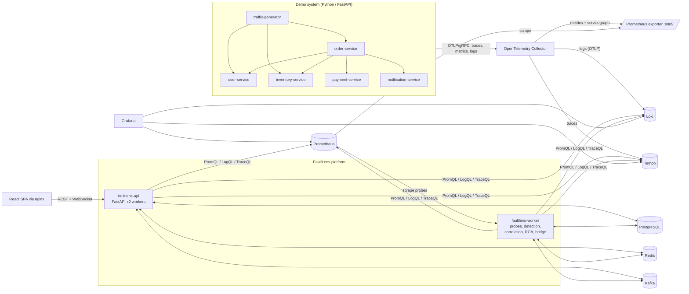
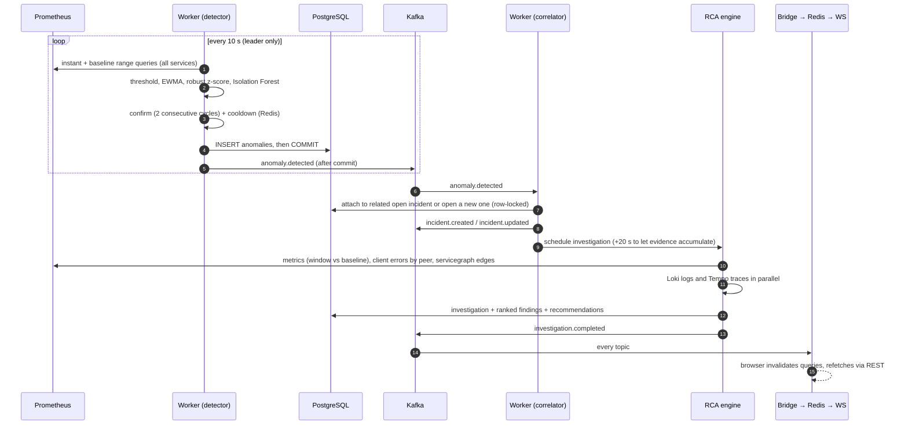
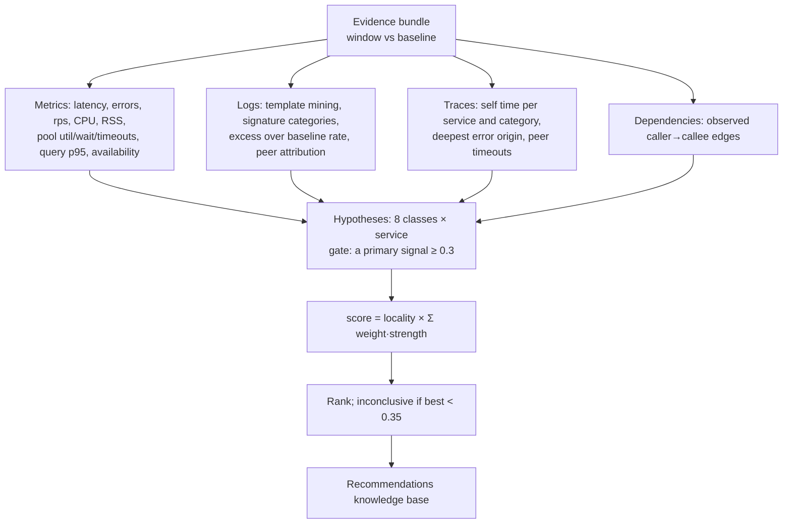
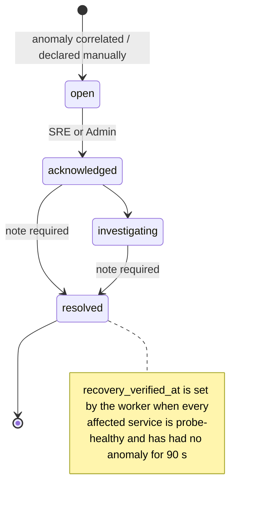

# FaultLens Architecture

FaultLens is a self-contained observability and root-cause-analysis platform plus the system it observes:
five instrumented microservices under continuous, reproducible load.

## 1. System overview



Every container is defined in `docker-compose.yml`; host ports bind to `127.0.0.1` only.

## 2. Components

| Component | Responsibility | Code |
|---|---|---|
| Demo services | Real REST workflows backed by PostgreSQL (`shop` DB); OTel instrumentation; structured JSON logs; bounded, auto-expiring fault injection | `services/` |
| Shared runtime | Telemetry bootstrap, JSON logging with trace context, request middleware, instrumented DB pool, fault manager | `services/common/faultlens_common/` |
| Traffic generator | Poisson arrivals, seeded RNG, profiles (normal/high/spike/random), control API | `services/traffic_generator/` |
| OTel Collector | Single OTLP ingestion; routes signals; servicegraph connector builds dependency edges from spans | `deploy/otel-collector/` |
| faultlens-api | REST + WebSocket API, auth/RBAC, incident lifecycle, on-demand RCA, assistant, fault-lab proxy | `backend/app/api`, `backend/app/main.py` |
| faultlens-worker | Health probes, anomaly detection loop (leader-elected), Kafka consumers (correlator, realtime bridge), scheduled RCA, recovery verification | `backend/app/workers/main.py` |
| Intelligence engines | Detectors, log analysis, trace analysis, dependency graph, RCA scoring, recommendations | `backend/app/engines/` |
| AI explanation layer | Deterministic narrator, optional LLM, evidence validator | `backend/app/ai/` |
| Frontend | 10 pages + login, React Query, WebSocket live client | `frontend/` |

## 3. Core workflows

### 3.1 Detection → incident → investigation



### 3.2 RCA scoring



Failure classes: DB pool exhaustion, slow DB queries, service slowdown/timeouts, high CPU, memory pressure,
service unavailable (downstream failure), traffic overload, HTTP 5xx spike. The full signal tables are in
`backend/app/engines/rca/hypotheses.py`; the rationale is in [ADR-006](docs/adr/0006-deterministic-rca.md).

### 3.3 Trace ↔ log correlation

The OTel log bridge stamps every log record emitted inside a span with that span's `trace_id`/`span_id`
(omitted when there is no valid context). Loki stores them as structured metadata, so
`{service_name="payment-service"} | trace_id="…"` returns the exact lines of one request. The UI links in
both directions (log line → trace waterfall; span → logs), Grafana's Tempo/Loki datasources are provisioned
with the same correlation, and the RCA engine uses trace ids from log samples as evidence links.

### 3.4 Real-time delivery

See [ADR-008](docs/adr/0008-websocket-delivery.md): Kafka → bridge → Redis Pub/Sub → per-process hub →
authenticated WebSocket → React Query invalidation → REST refetch.

## 4. Incident lifecycle



Transitions lock the incident row; invalid transitions return `409 invalid_transition`; each change writes a
timeline entry, an audit event and a Kafka event.

## 5. Fault injection safety

Faults are applied *inside* the target service (`faultlens_common/faults.py`) through an internal admin API that
requires a shared token (`FAULT_ADMIN_TOKEN`). They work only when `ENVIRONMENT ∈ {local, demo, test}` **and**
`FAULT_INJECTION_ENABLED=true`. The FaultLens API proxies them for SRE/Admin users only, with rate limiting
and an audit record. Every fault has hard parameter limits (latency ≤ 10 s, memory ≤ 384 MB, ≤ 2 CPU threads,
duration ≤ 15 min) and auto-expires; "Restore all" clears everything at once.

## 6. Architecture Decision Records

| ADR | Decision |
|---|---|
| [001](docs/adr/0001-fastapi-backend.md) | FastAPI for backend and services |
| [002](docs/adr/0002-postgresql.md) | PostgreSQL for persistent application data |
| [003](docs/adr/0003-kafka-events.md) | Kafka for asynchronous event processing |
| [004](docs/adr/0004-redis.md) | Redis for caching, coordination and fan-out |
| [005](docs/adr/0005-opentelemetry.md) | OpenTelemetry instrumentation architecture |
| [006](docs/adr/0006-deterministic-rca.md) | Deterministic evidence-based RCA as source of truth |
| [007](docs/adr/0007-auth-rbac.md) | Authentication and RBAC design |
| [008](docs/adr/0008-websocket-delivery.md) | WebSocket event delivery |
| [009](docs/adr/0009-telemetry-boundaries.md) | Prometheus / Loki / Tempo data boundaries |

## 7. Directory layout

```
FaultLens/
├── backend/              FastAPI API + worker, engines, Alembic migrations, tests
│   ├── app/{api,core,db,engines,events,ai,ml,services,telemetry,workers}
│   ├── migrations/
│   └── tests/
├── services/             five demo microservices + traffic generator + shared runtime + tests
├── frontend/             React + TypeScript + Vite + Tailwind SPA, Vitest tests, nginx config
├── deploy/               Collector, Prometheus, Loki, Tempo, Grafana, Postgres init
├── e2e/                  integration tests, end-to-end scenario, live RCA evaluation, benchmarks
├── docs/adr/             Architecture Decision Records
├── scripts/              setup (.env generation), benchmark, screenshots, packaging helpers
├── .github/workflows/    CI (backend, frontend, images + compose)
└── docker-compose.yml
```
