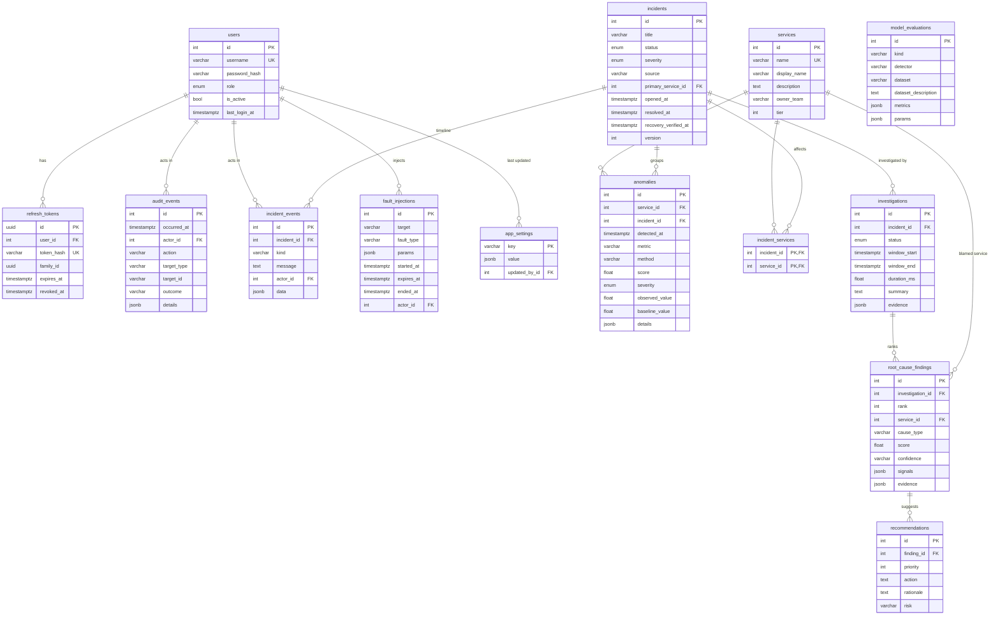

# Database Design

PostgreSQL 16 holds FaultLens' **derived, durable state**. Raw telemetry stays in Prometheus/Loki/Tempo
([ADR-009](docs/adr/0009-telemetry-boundaries.md)). The schema is created only by Alembic
(`backend/migrations/versions/0001_initial_schema.py`). `alembic check` verifies the models and migrations
match, and the migration is tested by running upgrade → downgrade → upgrade.

## Entity-relationship diagram

## Constraints and integrity rules

| Table | Rule | Purpose |
|---|---|---|
| users | `UNIQUE(username)`, `CHECK char_length(username) >= 3`, enum role | identity |
| refresh_tokens | `UNIQUE(token_hash)`, FK → users `ON DELETE CASCADE`, index on `family_id` | rotation and family revocation |
| incidents | `CHECK status <> 'resolved' OR resolved_at IS NOT NULL`, `CHECK source IN ('auto','manual')`, `version` column for optimistic locking | lifecycle consistency |
| incident_services | composite PK | no duplicate affected-service links |
| anomalies | `CHECK method IN (threshold, zscore, moving_average, isolation_forest)` | valid detector provenance |
| investigations | `CHECK window_end >= window_start` | valid evidence window |
| root_cause_findings | `UNIQUE(investigation_id, rank)`, `CHECK 0 <= score <= 1` | well-formed ranking |
| model_evaluations | `CHECK kind IN ('anomaly','rca')` | evaluation provenance |
| services | `UNIQUE(name)`, `CHECK tier BETWEEN 1 AND 3` | catalogue |

Deletion behaviour: deleting an incident cascades to its timeline, links and investigations (and from there to
findings and recommendations); anomalies keep existing with `incident_id = NULL`; user deletion nulls actor
references, so audit history is preserved.

## Indexes (query-driven)

| Index | Serves |
|---|---|
| `ix_incidents_status_opened (status, opened_at)` | incident list filtered by status, newest first; correlator's "active incidents" scan |
| `ix_anomalies_service_time (service_id, detected_at)` | per-service anomaly history; recovery check ("any anomaly in the last 90 s?") |
| `ix_anomalies_detected_at` | anomaly list and per-minute trend |
| `ix_anomalies_incident_id` | incident detail |
| `ix_incident_events_incident_time` | incident timeline |
| `ix_investigations_incident_id` | latest investigation per incident |
| `ix_audit_events_occurred_at`, `ix_audit_events_action` | audit log browsing and filtering |
| `ix_fault_injections_active (ended_at, expires_at)` | active fault lookup |

## JSONB usage (deliberately limited)
- `root_cause_findings.signals`: the per-signal score breakdown (name, weight, strength, contribution, value, source).
- `investigations.evidence`: a bounded evidence snapshot (aggregates, ≤ 8 log templates per service, ≤ 6 example traces).
- `anomalies.details`: detector-specific parameters (z, robust scale, EWMA, IF contributions).
- `audit_events.details`, `incident_events.data`, `app_settings.value`, `model_evaluations.metrics/params`.

## Concurrency
- State transitions: `SELECT … FOR UPDATE` on the incident row, then validate the transition, then write; a
  stale write raises `StaleDataError`, which maps to HTTP 409.
- Correlation: the worker locks candidate incidents while attaching an anomaly; investigations use a Redis lock per incident.
- Recovery checks use `FOR UPDATE SKIP LOCKED` so they never block user transitions.

## Demo service data (`shop` database)
Separate database and role. Each service owns a schema (`users`, `orders`, `payments`, `inventory`,
`notifications`) created idempotently at start-up under a PostgreSQL advisory lock. This is business data for
the simulated company, not FaultLens state, so it is intentionally outside Alembic.
