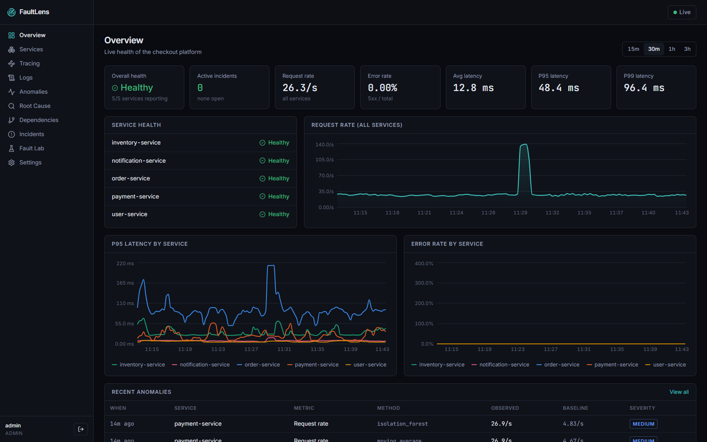
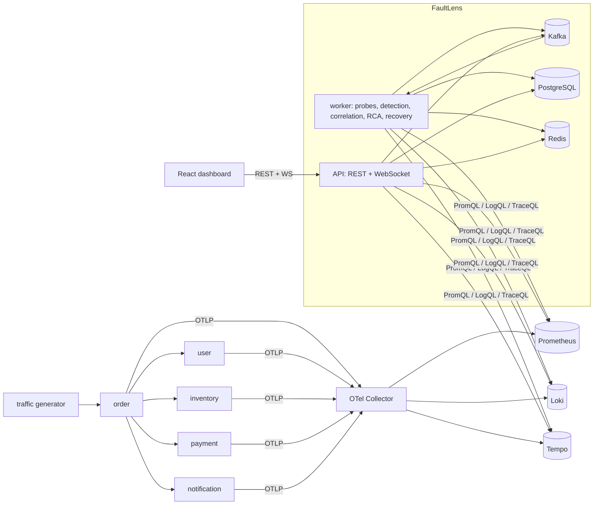
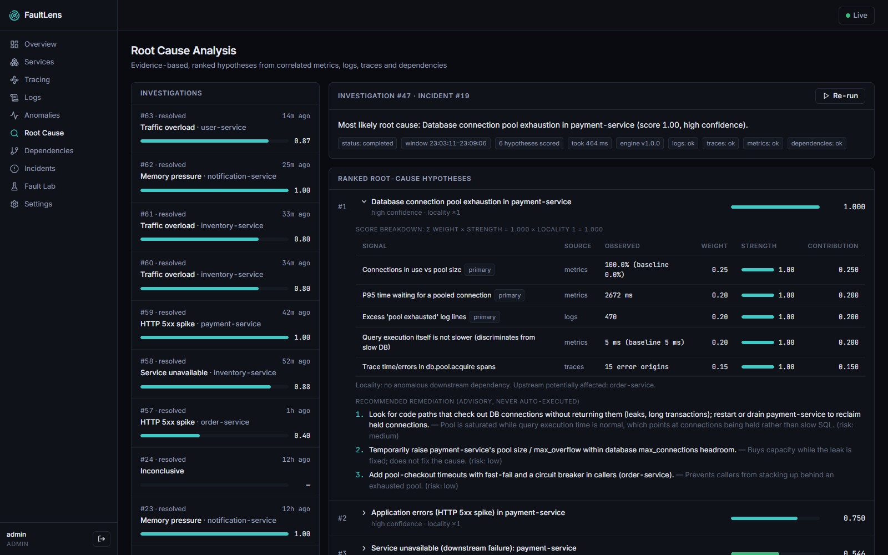
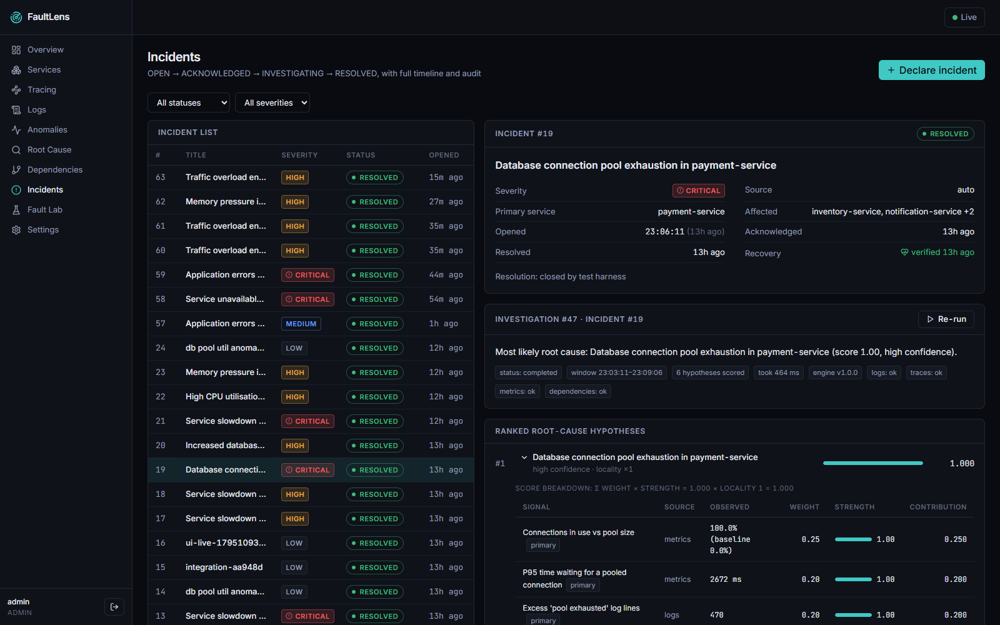
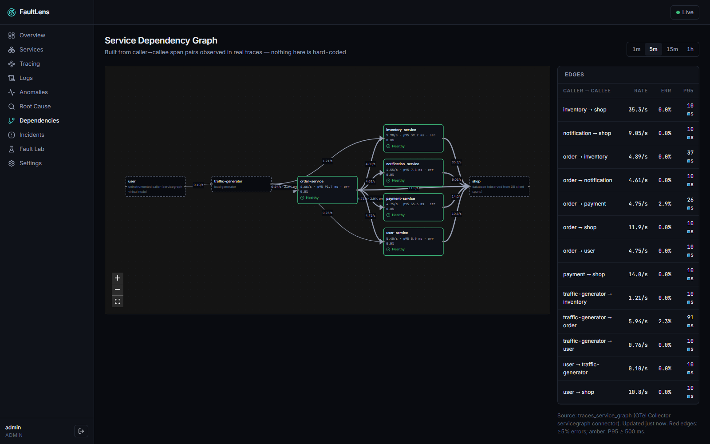
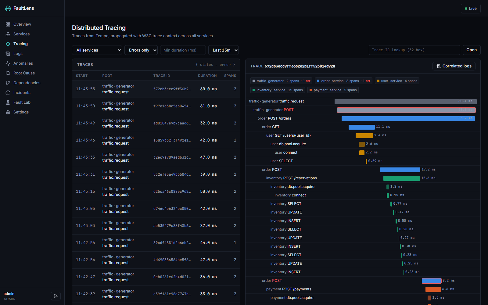
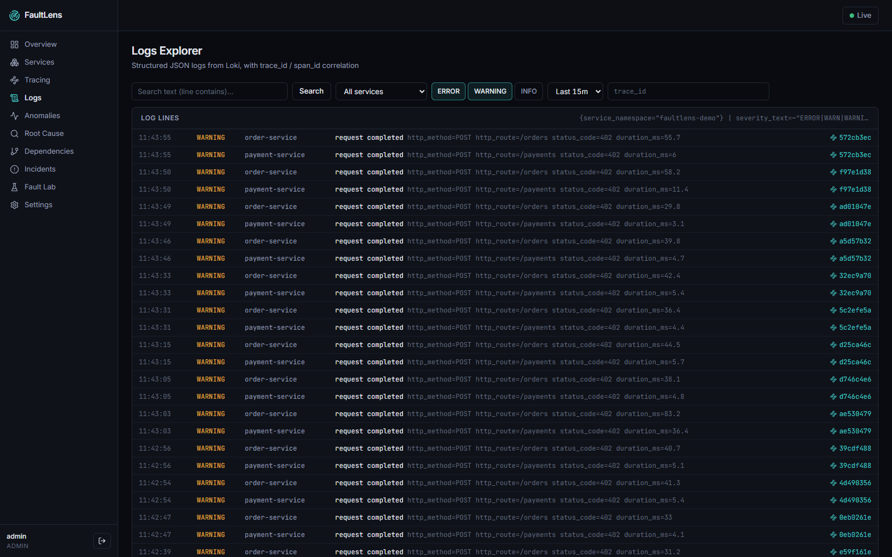
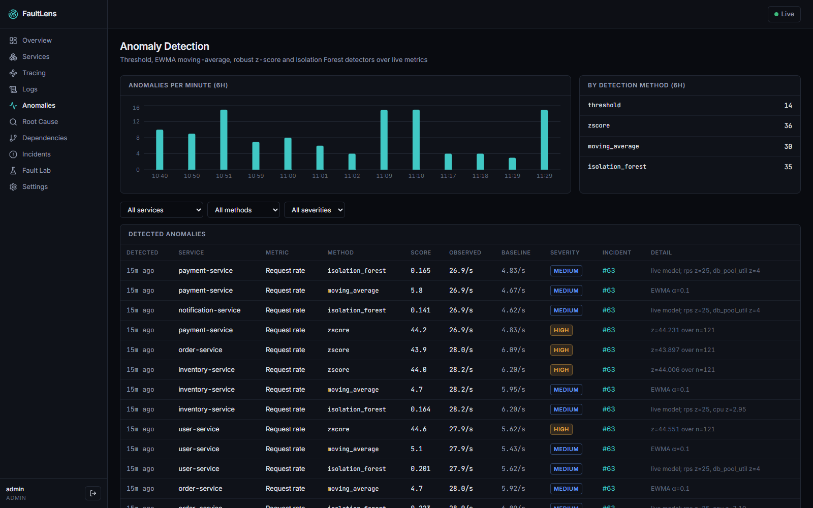
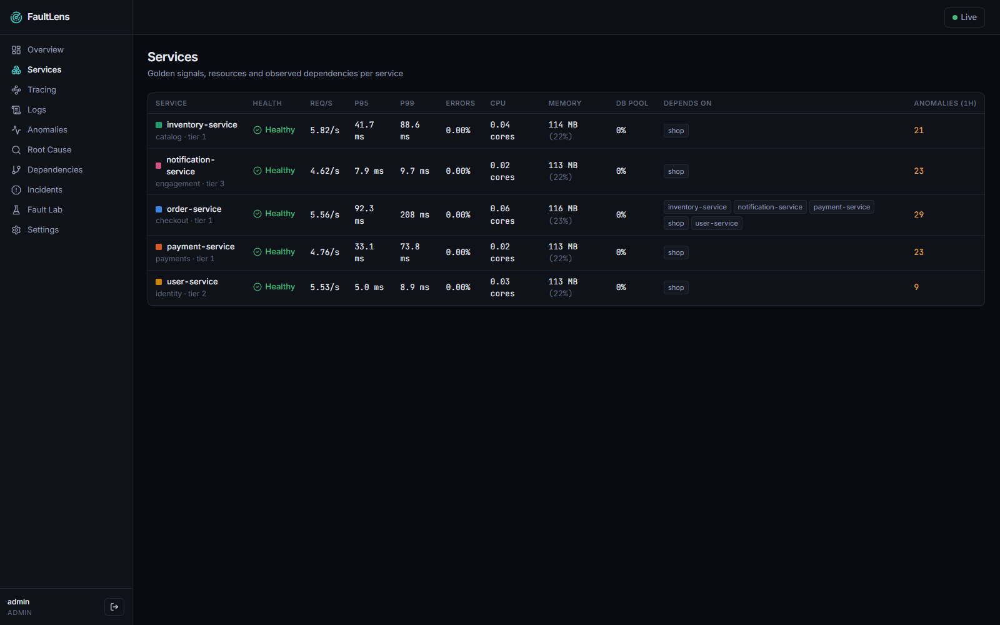
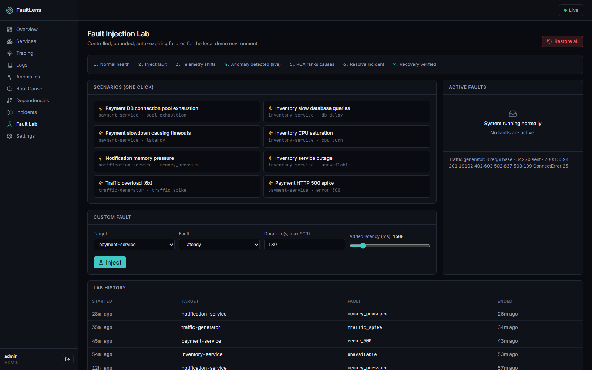

# FaultLens

**Intelligent distributed-system observability and evidence-based root-cause analysis.**

FaultLens watches a five-service checkout system through real OpenTelemetry metrics, logs and traces. It
detects anomalies with four complementary detectors, groups them into incidents, investigates them by
correlating metrics, logs, traces and observed dependencies, and ranks root-cause hypotheses with a
transparent score. Everything is shown live on a React dashboard. It runs entirely locally with Docker Compose,
needs no paid service or AI key, and ships a Fault Injection Lab so you can break things on purpose and watch
the investigation happen.



---

## Contents
[Problem](#the-problem) · [Features](#features) · [Architecture](#architecture) · [Tech stack](#technology-stack) ·
[Screenshots](#screenshots) · [Install & run (Windows)](#installation--execution-windows-powershell) ·
[Fault injection demo](#fault-injection-demonstration) · [Testing](#testing) · [Results](#measured-results) ·
[API](#api) · [Limitations](#limitations) · [Future scope](#future-scope) · [Docs](#documentation)

## The problem
When one microservice degrades, alerts fire everywhere: the checkout API is slow, error rates rise upstream,
dashboards turn red. Telling the *cause* from the *symptoms* means jumping between metrics, logs and traces
under time pressure. FaultLens automates that correlation and shows its reasoning: which signals point where,
by how much, and why a candidate was ranked down (for example, "its downstream dependency is the one actually failing").

## Features
- **Five instrumented microservices** (order, user, payment, inventory, notification) with real PostgreSQL
  workflows, W3C trace propagation, structured JSON logs carrying `trace_id`/`span_id`/`request_id`, and a
  reproducible traffic generator (seeded Poisson arrivals; normal/high/spike/random profiles).
- **Real telemetry pipeline**: OTel SDK → Collector → Prometheus (metrics), Loki (logs), Tempo (traces); Grafana provisioned with trace↔log links.
- **Dynamic dependency graph** built from observed client/server span pairs (Collector servicegraph), not hard-coded.
  Nodes are classified as instrumented services (with live golden signals and health), clients (the traffic
  generator, and the servicegraph's virtual `user` node for uninstrumented callers) or databases (`shop`,
  observed from DB client spans).
- **Anomaly detection**: static thresholds, EWMA moving average, robust z-score (median/MAD) and Isolation Forest,
  with 2-cycle confirmation and cooldowns, configurable at runtime; evaluated on a labelled synthetic dataset.
- **Evidence-based RCA engine**: 8 failure classes × services, `score = locality × Σ weight·strength` over signals
  from metrics, log patterns, trace self-time/error origins and dependencies; explicit *inconclusive* outcome;
  remediation recommendations.
- **AI investigation assistant**: deterministic narrator by default; optional Anthropic or OpenAI-compatible
  (e.g. local Ollama) provider whose output is validated against the evidence and rejected on unsupported claims.
- **Incident management**: OPEN → ACKNOWLEDGED → INVESTIGATING → RESOLVED with row-locked transitions, timeline,
  audit trail, automatic recovery verification.
- **Real-time dashboard**: authenticated WebSocket stream (Kafka → Redis Pub/Sub → WS) with reconnect/backoff.
- **Auth & RBAC**: argon2id, short-lived JWTs, rotating HttpOnly refresh tokens with reuse detection; Admin / SRE Engineer / Viewer enforced in the backend.
- **Fault Injection Lab**: latency, HTTP 500s, outage, slow DB, pool exhaustion, CPU burn, memory pressure,
  traffic spike; bounded, audited, auto-expiring, local-only.
- **Tests & CI**: 118 backend + 12 service + 17 frontend tests, integration, E2E and Playwright browser tests, GitHub Actions workflows.

## Architecture



Details, sequence diagrams and the incident state machine are in **[ARCHITECTURE.md](ARCHITECTURE.md)**; the
design trade-offs are in the **[Architecture Decision Records](docs/adr/)**:
[FastAPI](docs/adr/0001-fastapi-backend.md) · [PostgreSQL](docs/adr/0002-postgresql.md) ·
[Kafka](docs/adr/0003-kafka-events.md) · [Redis](docs/adr/0004-redis.md) ·
[OpenTelemetry](docs/adr/0005-opentelemetry.md) · [Deterministic RCA](docs/adr/0006-deterministic-rca.md) ·
[Auth/RBAC](docs/adr/0007-auth-rbac.md) · [WebSockets](docs/adr/0008-websocket-delivery.md) ·
[Telemetry boundaries](docs/adr/0009-telemetry-boundaries.md).

## Technology stack

| Area | Technology (pinned) |
|---|---|
| Backend | Python 3.12, FastAPI 0.115, Pydantic 2.10, SQLAlchemy 2.0 (async, asyncpg), Alembic 1.14 |
| Data | PostgreSQL 16.4, Redis 7.4, Apache Kafka 3.8 (KRaft, aiokafka) |
| Observability | OpenTelemetry SDK 1.29 / instrumentation 0.50b0, Collector-contrib 0.114, Prometheus 2.55, Loki 3.3, Tempo 2.6, Grafana 11.3 |
| ML / analysis | scikit-learn 1.5 (Isolation Forest), NumPy 2.1, pandas 2.2 |
| Security | argon2-cffi, PyJWT |
| Frontend | React 18.3, TypeScript 5.6, Vite 5.4, Tailwind 3.4, React Query 5, Recharts 2.13, React Flow 12, Lucide |
| Testing | pytest 8, Vitest 2, Testing Library, Playwright 1.49 |
| Infra | Docker, Docker Compose, GitHub Actions |

## Screenshots
All screenshots are captured from the running application by `frontend/e2e/screenshots.spec.ts` (real data, no
mocks; 1600×1000). The current set was captured on 2026-11-20 from the final build, with no faults active.

| | |
|---|---|
|  **Root cause analysis**: ranked hypotheses with the per-signal score breakdown (pool-exhaustion incident) |  **Incidents**: incident list, details, resolution and investigation |
|  **Dependency graph** from observed traces: services (solid), the `user` and traffic-generator clients and the `shop` database (dashed) |  **Trace waterfall** of an error trace across five services |
|  **Logs** filtered by level, with trace links |  **Anomalies**: detections per minute, per detector and per service |
|  **Services** golden signals and observed dependencies |  **Fault Injection Lab** with scenarios and history |

## Installation & execution (Windows PowerShell)

**Prerequisites:** Docker Desktop (with Compose v2), Git. For tests and development, also Python 3.12 (`py -3.12`)
and Node.js 20+. About 6 GB of free RAM for the full stack; the first build downloads about 3 GB of images.

```powershell
# 1. Get the code
Expand-Archive FaultLens.zip -DestinationPath .   # or: git clone <your repo>
cd FaultLens

# 2. Create .env with freshly generated local secrets (prints the initial admin password)
powershell -ExecutionPolicy Bypass -File scripts\setup.ps1

# 3. Build and start everything (17 containers)
docker compose up -d --build

# 4. Check health
docker compose ps
Invoke-RestMethod http://localhost:8000/api/v1/health
```

| URL | What |
|---|---|
| <http://localhost:3080> | FaultLens UI: user `admin`, password `BOOTSTRAP_ADMIN_PASSWORD` from `.env` |
| <http://localhost:8000/api/docs> | OpenAPI / Swagger |
| <http://localhost:3000> | Grafana (`admin` / `GRAFANA_ADMIN_PASSWORD`) |
| <http://localhost:9090> | Prometheus |

> **Changing the UI port?** If you publish the frontend on a host port other than 3080, add the new origin
> (for example `http://localhost:13080`) to `CORS_ORIGINS` in `docker-compose.yml`. The WebSocket endpoint rejects
> any `Origin` that is not listed there, so live updates would stop working.

> Statistical detectors need about 5 minutes of baseline traffic after the first start before they engage
> (thresholds work immediately).

> **Health may read `degraded` at first on a fresh install.** Loki and Tempo take a while to become ready, and
> until they do, the health endpoint reports `"status": "degraded"` with `loki` / `tempo` failing in `checks`.
> In one clean-install test (fresh ZIP extraction, new volumes), they took about 6.5 minutes to become ready.
> After that, the API reported `ok` with every check passing, without any container being restarted. Startup time
> depends on your machine and is not guaranteed. Wait for the telemetry backends to finish starting and re-run step 4
> before treating `degraded` as an installation failure.

Everyday commands (all via `scripts\faultlens.ps1`):

```powershell
scripts\faultlens.ps1 status            # container + dependency health
scripts\faultlens.ps1 logs payment-service
scripts\faultlens.ps1 test              # backend, services, frontend tests + lint
scripts\faultlens.ps1 test-live         # integration + Playwright against the running stack
scripts\faultlens.ps1 e2e               # full failure-lifecycle scenario (~5 min)
scripts\faultlens.ps1 reset-demo        # clear faults, incidents, anomalies, investigations (keeps users)
scripts\faultlens.ps1 down              # stop (keep data)   |  destroy = stop + delete volumes
```

## Fault injection demonstration
1. Sign in, then open **Overview**: all five services are healthy.
2. Open **Fault Lab** and click **"Payment DB connection pool exhaustion"**.
3. Within about 25 s the **Live** indicator shows `anomaly.detected` and `incident.created` arrives; Overview and
   Services turn red, with no refresh needed.
4. About 20 s later the investigation completes. **Root Cause** shows *Database connection pool exhaustion in
   payment-service* ranked first, with its evidence: pool 100% in use, about 2 s pool wait, excess "pool exhausted"
   log lines, error origins in `db.pool.acquire` spans, and *queries not slower* (which rules out a slow database).
   order-service's symptoms rank lower because traces attribute the failure downstream.
5. Click a trace id → waterfall → **Correlated logs**; ask the assistant "how do I fix it?".
6. On **Incidents**: Acknowledge → Start investigating → **Fault Lab: Restore all** → Resolve with a note.
7. About 90 s after metrics normalise, the timeline shows **recovery.verified**.

Repeat with any of the other seven scenarios. Viewers can watch everything but every control is disabled,
and the backend returns 403 even if they try anyway.

## Testing
See **[TESTING.md](TESTING.md)**. Summary of the latest local runs:

| Suite | Result |
|---|---|
| Backend (unit + API/DB + WebSocket) | 118 passed |
| Demo services | 12 passed |
| Frontend (Vitest) | 17 passed |
| Integration against live stack | 8 passed, 0 failed, 0 skipped (`e2e/test_integration.py`, 67.26 s, 2026-11-20). Re-run with `scripts\faultlens.ps1 test-live` |
| End-to-end failure lifecycle | passed on 2026-11-19. The test writes `e2e/results/e2e_timings.json` only after every assertion passes: anomaly 25.0 s, incident 25.1 s, RCA 45.4 s, recovery verified 140.4 s after reset |
| Playwright browser tests (Edge) | 4 passed, 0 failed, 1 skipped (5.2 s, 2026-11-20). The 4 tests in `frontend/e2e/ui.spec.ts` cover login, page navigation and logout; the dependency graph built from observed traffic; trace waterfall and trace-to-log navigation; and a live incident appearing without reload, with Viewer read-only behaviour. The skipped test is `frontend/e2e/screenshots.spec.ts`, which skips by design unless `CAPTURE=1` is set |
| Lint / type-check / build / compose config | clean |

These results come from separate runs on different dates, not one session in which every suite passed together.
The integration and Playwright suites were last run on 2026-11-20; the rows that give no date come from earlier
runs recorded in TESTING.md.

CI workflows are in `.github/workflows/` (backend, frontend, images + compose + integration). They were
**validated locally** by running the same commands; they have not run on GitHub yet.

## Measured results
Full methodology, environment and raw numbers: **[BENCHMARKS.md](BENCHMARKS.md)**. All figures come from one
Windows 11 machine (16 logical CPUs, 15.7 GB RAM) running the whole stack, so they are not capacity claims.
Raw console logs such as `e2e/results/benchmark.log` are excluded from the distributable ZIP; the results
and methodology are documented in BENCHMARKS.md.

**Root-cause analysis: 8 controlled fault-injection scenarios, one run each** (`e2e/results/rca_evaluation.json`)

Each scenario injects one of the 8 failure classes the RCA engine models (pool exhaustion, slow DB queries,
timeouts, CPU saturation, service outage, HTTP 500s, traffic overload, memory pressure) into the demo system.
FaultLens then has to detect it and rank the cause with no knowledge of what was injected.

| | Result |
|---|---|
| Faults detected | 8 / 8 |
| Expected cause ranked #1, first automatic investigation | 8 / 8 |
| Expected cause ranked #1, re-run at T+90 s | 8 / 8 |
| Expected cause in the top 3 (both checkpoints) | 8 / 8 |
| Injection → first anomaly | 19.2–37.9 s (evaluator-reported median 29.0 s) |

Treat this as a check that the engine handles the failure classes it was designed for, not as a measure of
general diagnostic accuracy. The faults are controlled and clean, each scenario ran once, and the results are
not repeated trials. In the traffic-spike scenario, the cause (`traffic_overload`) was right, but it was
attributed to inventory-service, the entry point, rather than to the system as a whole.

**Performance** (`e2e/results/benchmark.json`; 8 concurrent workers, 15 s phases, with the 8 req/s background traffic running)

| Measurement | Result |
|---|---|
| `GET /services` (cached), 6,600 requests | 439.6 req/s · p50 18.71 ms · p95 29.72 ms · p99 37.71 ms · 0 errors |
| Checkout `POST /orders` (5 services, 5 DB transactions), 1,216 orders | 80.8 orders/s · p50 90.58 ms · p95 145.38 ms · p99 255.08 ms · 0 errors |
| Sequential API reads (30 per endpoint) | p50 2.86–7.50 ms for 7 of 9 endpoints; `/traces` 14.41 ms, `/logs` 55.52 ms |
| Request → queryable telemetry (5 samples) | trace in Tempo: median 9.89 s · log in Loki: median 7.13 s |
| RCA investigation duration (worker histogram) | p50 ≈ 0.36 s · p95 ≈ 0.49 s |

## API
REST under `/api/v1` plus the WebSocket `/api/v1/ws/events`. Reference: **[API_DOCUMENTATION.md](API_DOCUMENTATION.md)**
and the live OpenAPI UI. The database schema is in **[DATABASE_DESIGN.md](DATABASE_DESIGN.md)**.

## Limitations
- **The RCA engine is hand-designed.** Weights encode knowledge of 8 failure classes. It was evaluated on 8
  controlled faults injected into this demo system, one run each, not on production incidents. It will not
  reliably diagnose classes it does not model (network partitions, bad deploys with no resource signature,
  cascading retries across many hops). In the one traffic-spike run, a system-wide cause was attributed to
  a single entry service (see BENCHMARKS.md).
- **Detector metrics come from synthetic data** (clearly labelled); live behaviour depends on traffic shape.
  Baselines are contaminated by long incidents (a sustained fault slowly becomes "normal").
- **Small scale by design**: single-node Kafka, Postgres, Redis and Collector; 8 rps of default traffic.
  Numbers in BENCHMARKS.md are from one machine and are not capacity claims.
- **Security is demo-grade**: HTTP only by default, HS256 single secret, no MFA, unauthenticated Prometheus/Loki/Tempo on localhost. See [SECURITY.md](SECURITY.md).
- Real-time events are at-most-once per connection (the UI re-reads via REST, so it stays consistent).
- Events are published after commit but without an outbox table, so a crash between the two can lose an event.

## Future scope
Transactional outbox; learned RCA weights from labelled incident history; change-event correlation (deploys,
config); SLO/burn-rate alerting; multi-replica worker sharding; OIDC/SSO and MFA; Kubernetes manifests with
autoscaling; trace-sampling strategies for higher volumes.

## Documentation
[ARCHITECTURE](ARCHITECTURE.md) · [ADRs](docs/adr/) · [API](API_DOCUMENTATION.md) · [DATABASE](DATABASE_DESIGN.md) ·
[TESTING](TESTING.md) · [BENCHMARKS](BENCHMARKS.md) · [SECURITY](SECURITY.md) · [CONTRIBUTING](CONTRIBUTING.md) ·
[DEVELOPMENT_STATUS](DEVELOPMENT_STATUS.md)

## Publishing to GitHub (after you have verified the ZIP)
```powershell
cd FaultLens
git init -b main
git add .
git status            # confirm .env is NOT listed (it is git-ignored)
git commit -m "Initial commit: FaultLens"
git remote add origin https://github.com/<you>/faultlens.git
git push -u origin main
```
GitHub Actions then runs the three workflows on every push and pull request.

## License
[MIT](LICENSE)
